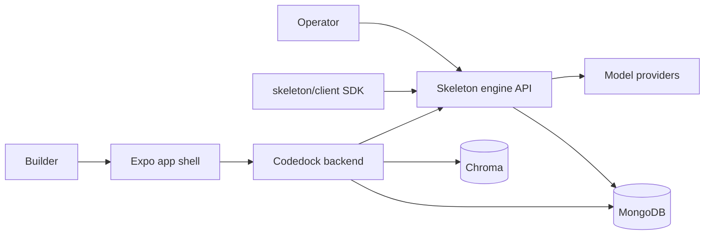

# C4 context

Skeleton is the engine and product shell for an AI game builder. People use the Expo web app and the operator CLI. The app foundation client calls the engine HTTP API. External model providers sit behind `skeleton/provider_runtime.py`. MongoDB and Chroma hold durable state. GitHub is the source host. Secrets stay in the process environment and the vault, not on HTTP.

The client SDK in progress covers auth, agents, builds, and stream parsing. Projects are published in `docs/architecture/contracts/projects.md` (`skeleton.projects.v1` at `1.1.0`) as the contract for the #4097 router moving to `/api/v1/projects`. A build started there returns an `execution_id` for `/api/v1/engine/executions/{execution_id}`.
