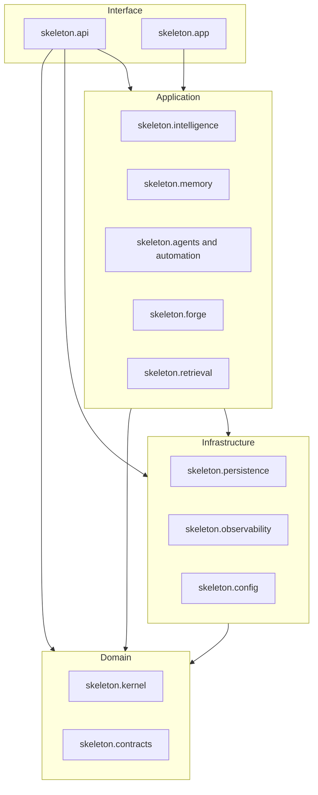

# C4 component

Inside the engine process the dependency direction is domain, then infrastructure, then application, then interface. See [logical layers](../LOGICAL_LAYERS.md).

| Component | Boundary contract | HTTP today |
|-----------|-------------------|------------|
| Kernel | `skeleton.contracts.subsystem_boundaries.KernelEventBoundary` | None. Kernel does not serve HTTP. |
| Agents | `AgentTaskBoundary` | Swarm routers under `/api/v1/swarm`, mounted by `create_app`. |
| Memory | `MemoryWriteBoundary` plus `skeleton.contracts.memory_record` | Memory routes on the main router. Mongo is behind persistence. |
| GameForge | `GameForgeCommandBoundary` for `run` and `intake` only | Charter-gated `POST /api/v1/gameforge/run` and `/intake` on `skeleton.api.routes`. Sidecar handlers remain importable and are not mounted. |
| API | `ApiErrorBoundary` and `skeleton.api.errors` | `create_app`. |
| Projects | `skeleton.contracts.projects` | Not mounted. Schema links `build_ids` to engine `execution_id`. |

Cortex HTTP, including `/api/v1/secrets`, stays unmounted. `reject_cortex_secret_routes` walks nested routers and refuses startup if a secrets path is registered.

Provider SDKs are not imported from these components. Credential-bearing model calls stay in `skeleton/provider_runtime.py`.
